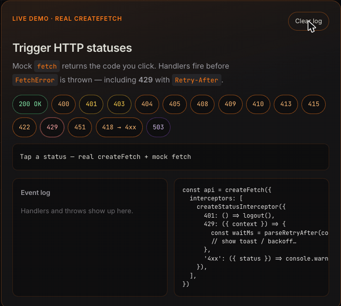

# tanstack-fetch

**Typed Fetch client designed for TanStack Query.**

> Independent project — not an official TanStack package and not affiliated with the TanStack maintainers.

Returns data · throws `FetchError` · honors `AbortSignal` · SSR · SSE · React · Vue/Nuxt · Solid · Angular · Svelte · tRPC · DevTools

[](https://www.npmjs.com/package/tanstack-fetch)
[](https://www.npmjs.com/package/tanstack-fetch)
[](https://bundlephobia.com/package/tanstack-fetch)
[](./LICENSE)
[](https://github.com/mohamadgarmabi/tanstack-fetch/actions/workflows/ci.yml)
[](https://github.com/mohamadgarmabi/tanstack-fetch)

<p align="center">
  
</p>

<p align="center"><a href="https://mohamadgarmabi.github.io/tanstack-fetch/examples/playground">▶ Try it in the playground</a></p>

## Docs

**→ [mohamadgarmabi.github.io/tanstack-fetch](https://mohamadgarmabi.github.io/tanstack-fetch/)**

Guides, API, playground, Vue/Nuxt, SSR, SSE, upload, tRPC, DevTools, and comparison live on the site.

## Install

```bash
npm install tanstack-fetch @tanstack/react-query
# Vue / Nuxt
npm install tanstack-fetch vue
```

```ts
import { createFetch } from 'tanstack-fetch'
import { useQuery } from '@tanstack/react-query'

const api = createFetch({ baseUrl: 'https://api.example.com' })

useQuery({
  queryKey: ['users'],
  queryFn: ({ signal }) => api.get<User[]>('/users', { signal }),
})
```

## Entry points

| Import                    | Use                                                      |       gzip |
| ------------------------- | -------------------------------------------------------- | ---------: |
| `tanstack-fetch`          | Slim HTTP (add features via `interceptors`)              | **3.68KB** |
| `tanstack-fetch/sse`      | Full HTTP (shortcuts, `upload()`) + `api.sse()`          | **6.43KB** |
| `tanstack-fetch/full`     | Alias of `/sse` for when you only need the full HTTP API |       same |
| `tanstack-fetch/live`     | HTTP + `api.sse()` / `ws()` / `transport()` / `stream()` | **8.84KB** |
| `tanstack-fetch/plugins`  | Interceptor factories                                    | **1.22KB** |
| `tanstack-fetch/react`    | `FetchProvider`, `useFetch`, `useSse`, `useWs`           | **0.99KB** |
| `tanstack-fetch/vue`      | `createFetchPlugin`, `useFetch`, `useSse`, `useWs`       | **0.94KB** |
| `tanstack-fetch/solid`    | `FetchProvider`, `useFetch`, `useSse`, `useWs`           |   optional |
| `tanstack-fetch/svelte`   | `setFetchClient`, `useFetch`, `useSse`, `useWs`          |   optional |
| `tanstack-fetch/angular`  | `provideFetchClient`, `injectFetch`, `useSse`, `useWs`   |   optional |
| `tanstack-fetch/trpc`     | tRPC link                                                | **3.28KB** |
| `tanstack-fetch/devtools` | Request dock                                             | **8.70KB** |

Minified ESM, `gzip` measured locally after `npm run build` (`npm run size`).

The core takes auth, status handlers and plugins as interceptors from `tanstack-fetch/plugins`. Option shortcuts (`getToken`, `onUnauthorized`, `plugins: [...]`), `upload()` and progress events live on `tanstack-fetch/sse` / `/live` and the framework providers:

```ts
import { createFetch } from 'tanstack-fetch'
import { createAuthInterceptor, createStatusInterceptor } from 'tanstack-fetch/plugins'

const api = createFetch({
  baseUrl: 'https://api.example.com',
  interceptors: [
    createAuthInterceptor({ getToken: () => localStorage.getItem('access_token') }),
    createStatusInterceptor({ 401: () => logout() }),
  ],
})
```

HTTP and network failures throw `FetchError`. A cancelled `signal` or an elapsed `timeoutMs` rejects with the platform `AbortError` / `TimeoutError` instead — check those with `isAbortError(error)` ([Errors guide](https://mohamadgarmabi.github.io/tanstack-fetch/guide/errors)).

## Compared to axios / ky / ofetch

| Need                               | tanstack-fetch                       | axios                                      | ky                        | ofetch                             |
| ---------------------------------- | ------------------------------------ | ------------------------------------------ | ------------------------- | ---------------------------------- |
| Drop into TanStack Query `queryFn` | Returns data, throws, takes `signal` | Adapt                                      | Adapt                     | Adapt                              |
| Typed error with status / body     | `FetchError` + `isFetchError`        | `AxiosError` (`response.status` / `.data`) | `HTTPError` (`.response`) | `FetchError` (`.status` / `.data`) |
| Handlers for 401–429               | First-class                          | Custom                                     | Custom                    | Custom                             |
| Refresh token + single-flight      | Built-in interceptor                 | Custom                                     | Custom                    | Custom                             |
| Next.js SSR cookies                | `ssr-forward`                        | Custom                                     | Custom                    | Custom                             |
| SSE with Authorization             | `tanstack-fetch/sse`                 | No                                         | No                        | No                                 |
| File upload + progress             | `api.upload()` (`/sse`, `/live`)     | Yes                                        | Limited                   | Limited                            |
| tRPC transport                     | `tanstack-fetch/trpc`                | No                                         | No                        | No                                 |
| Bundle (HTTP core)                 | **3.68KB** gzip                      | Larger                                     | Small                     | Small                              |

Full write-up: [Comparison](https://mohamadgarmabi.github.io/tanstack-fetch/guide/comparison)

## Try it

- [Playground](https://mohamadgarmabi.github.io/tanstack-fetch/examples/playground)
- [StackBlitz examples](./examples)
- [Migrate from axios / ky / ofetch / fetch](https://mohamadgarmabi.github.io/tanstack-fetch/guide/migrate)
- [Doctor CLI](https://mohamadgarmabi.github.io/tanstack-fetch/guide/migrate#doctor) — `npx tanstack-fetch doctor`
- [What's new — 2.1.0](https://mohamadgarmabi.github.io/tanstack-fetch/blog/tanstack-fetch-2-1-0)
- [Changelog](./CHANGELOG.md)

## Support

If tanstack-fetch saves you time, a ⭐ on [GitHub](https://github.com/mohamadgarmabi/tanstack-fetch) helps other developers find it. Issues, ideas and PRs are welcome.

## License

[MIT](./LICENSE) · [Mohammad Garmabi](https://github.com/mohamadgarmabi)
