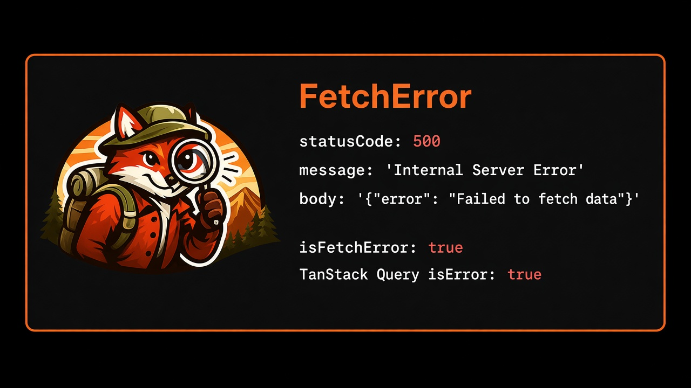

# Error API



Every failed HTTP call from `api.get`, `api.post`, `api.upload` and friends rejects with a typed **`FetchError`**, except aborts and timeouts. This page lists its fields, every error `code`, and the guards that narrow an `unknown` error in TypeScript. For a walkthrough, see the [Errors guide](/guide/errors).

```ts
import { createFetchError, isFetchError, isAbortError } from 'tanstack-fetch'
import type { FetchError, FetchErrorInfo } from 'tanstack-fetch'
```

## `FetchError` fields

`FetchError` is an `Error` with `name: 'FetchError'` and these read-only fields:

| Field     | Type                                 | Meaning                                                                              |
| --------- | ------------------------------------ | ------------------------------------------------------------------------------------ |
| `status`  | `number`                             | HTTP status. `0` when no response arrived (network error, dropped request)           |
| `code`    | `string`                             | Machine-readable code (see [Error codes](#error-codes))                              |
| `message` | `string`                             | The body's string `message` when present, else `Request failed with status N`        |
| `body`    | `unknown`                            | Parsed error body. Raw text when the body is not valid JSON                          |
| `headers` | `Headers`                            | Response headers. Empty `Headers` when there was no response                         |
| `result`  | `FetchResult<never, FetchErrorInfo>` | The failed result the error was built from (`{ ok: false, status, error, headers }`) |

`FetchErrorInfo` is the plain-object form, `{ status, code, message, body }`. Interceptors see it as `context.error`.

## Error codes

| `code`            | When                                                                                   | `status` |
| ----------------- | -------------------------------------------------------------------------------------- | -------- |
| from the body     | Non-2xx response whose JSON body has a string `code`, e.g. `{ "code": "EMAIL_TAKEN" }` | real     |
| `HTTP_ERROR`      | Any other non-2xx response, including non-JSON bodies such as an HTML 502 page         | real     |
| `PARSE_ERROR`     | 2xx response whose JSON body can't be parsed. Raw text is in `body`                    | real     |
| `NETWORK_ERROR`   | The connection failed: DNS, refused, CORS, offline                                     | `0`      |
| `REQUEST_DROPPED` | An `onRequest` interceptor returned `{ action: 'drop' }` (since 2.2.1)                 | `0`      |
| `RETRY_EXHAUSTED` | An `onRequest` interceptor asked to retry when no retries were left                    | `0`      |
| `UNKNOWN`         | `createFetchError()` was called with a successful result                               | real     |

When `onResponseError` or `onRequestError` interceptors (status handlers, `retry-idempotent`) use up `maxRetries`, you get the **last real error**, such as a `503` with `HTTP_ERROR` or a `NETWORK_ERROR`, not `RETRY_EXHAUSTED`.

## What is not a `FetchError`

- **Aborts.** Aborting your `signal` rejects with the browser's `AbortError`. With `controller.abort(reason)` you get your `reason` back unchanged (since 2.2.1).
- **Timeouts.** When `timeoutMs` (default `30_000`) elapses, the call rejects with a `TimeoutError`. Requests with upload or download progress run over XHR and reject with `AbortError` instead.
- **Errors thrown by `onResponse` / `onResponseError` interceptors**, such as a schema validator, reject with that original error (since 2.2.1). They are not retried and do not run `onRequestError`.

Aborts and timeouts never run `onRequestError` and are never retried.

## `isFetchError` and `isAbortError`

```ts
isFetchError(error: unknown): error is FetchError
isAbortError(error: unknown): boolean
```

`isFetchError` checks `name === 'FetchError'` plus `status` and `code`, so it works across bundles and realms. `isAbortError` returns `true` for any `Error` or `DOMException` named `AbortError` or `TimeoutError`. A custom abort reason only matches if its `name` is one of those, so check `signal.aborted` when you abort with your own reason.

```ts
import { isAbortError, isFetchError } from 'tanstack-fetch'
import { api } from './api'

try {
  await api.post('/users', { body: { email } })
} catch (error) {
  if (isAbortError(error)) {
    if (error instanceof Error && error.name === 'TimeoutError') showToast('Request timed out')
    return // a user cancel is not worth a toast
  }
  if (isFetchError(error)) {
    if (error.code === 'EMAIL_TAKEN') return setFieldError('email', error.message)
    if (error.status === 0) return showToast('You appear to be offline')
  }
  throw error
}
```

## Narrow errors in TanStack Query

TanStack Query types `error` as `Error`, so narrow it with `isFetchError` in `onError`, in render, or in `retry`:

```ts
import { MutationCache, QueryCache, QueryClient, useMutation } from '@tanstack/react-query'
import { isFetchError } from 'tanstack-fetch'

export const queryClient = new QueryClient({
  queryCache: new QueryCache({
    onError: (error) => {
      if (isFetchError(error) && error.status === 401) redirectToLogin()
    },
  }),
  mutationCache: new MutationCache({
    onError: (error) => {
      if (isFetchError(error) && error.status >= 500) showToast('Server error, try again')
    },
  }),
  defaultOptions: {
    queries: {
      // Don't retry 4xx: the same request will fail the same way.
      retry: (failureCount, error) =>
        !(isFetchError(error) && error.status >= 400 && error.status < 500) && failureCount < 3,
    },
  },
})

export const useCreateUser = () =>
  useMutation({
    mutationFn: (email: string) => api.post('/users', { body: { email } }),
    onError: (error) => {
      if (isFetchError(error) && error.code === 'EMAIL_TAKEN') setFieldError('email', error.message)
    },
  })
```

## `createFetchError`

```ts
createFetchError(result: FetchResult<never, FetchErrorInfo>): FetchError
```

Builds a `FetchError` from a failed result. Use it in a custom wrapper or a `short-circuit` interceptor that needs to throw the same shape the client throws.

## Related

- [Errors guide](/guide/errors): status handlers and examples
- [Rate limit (429)](/recipes/rate-limit): `error.headers` and `Retry-After`
- [Plugin API](/api/plugins): `onRequestError`, `onResponseError` and decision actions
- [TanStack Query](/guide/tanstack-query): passing `signal` and query keys
