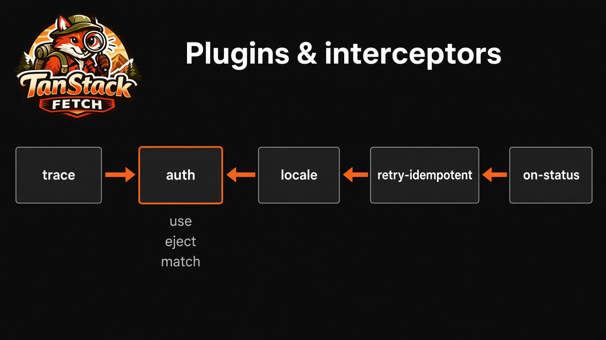

# Plugin API



Everything exported from `tanstack-fetch/plugins`: the interceptor factories, their options, the hooks an interceptor can implement, the actions a hook can return, and the order they run in. For a guided tour, see [Plugins & interceptors](/guide/plugins).

```ts
import {
  createAuthInterceptor,
  createRefreshTokenInterceptor,
  createStatusInterceptor,
  createRetryIdempotentInterceptor,
  createSseResumeInterceptor,
  createSsrForwardInterceptor,
  createTraceInterceptor,
  pluginFactories,
  resolvePlugins,
} from 'tanstack-fetch/plugins'
```

## Use interceptors with `createFetch`

On the core `tanstack-fetch` client, pass factories in `interceptors`. `tanstack-fetch/sse`, `/live`, `createTRPCFetch` and the framework providers also accept the names of the four built-in plugins in `plugins: […]`, plus option shortcuts (`getToken`, `onUnauthorized`, …) that build the auth and status interceptors for you.

```ts
import { createFetch } from 'tanstack-fetch'
import {
  createAuthInterceptor,
  createStatusInterceptor,
  createTraceInterceptor,
} from 'tanstack-fetch/plugins'

export const api = createFetch({
  baseUrl: 'https://api.example.com',
  interceptors: [
    createTraceInterceptor(),
    createAuthInterceptor({ getToken: () => localStorage.getItem('token') }),
    createStatusInterceptor({ 401: () => redirectToLogin() }),
  ],
})
```

## Interceptor factories

| Factory                                 | Name               | Order | Hooks                                        |
| --------------------------------------- | ------------------ | ----- | -------------------------------------------- |
| `createTraceInterceptor()`              | `trace`            | 0     | `onRequest`                                  |
| `createRefreshTokenInterceptor(config)` | `refresh-token`    | 10    | `onRequest`, `onResponseError`               |
| `createSsrForwardInterceptor()`         | `ssr-forward`      | 10    | `onRequest`                                  |
| `createAuthInterceptor(auth)`           | `auth`             | 15    | `onRequest`                                  |
| `createSseResumeInterceptor()`          | `sse-resume`       | 20    | `onSseEvent`, `onSseError`, `onSseReconnect` |
| `createRetryIdempotentInterceptor()`    | `retry-idempotent` | 80    | `onResponseError`                            |
| `createStatusInterceptor(handlers)`     | `on-status`        | 95    | `onResponseError`                            |

### `createTraceInterceptor()`

Sets `x-request-id` on every request and copies it to `context.meta.requestId`. It reuses `incoming.requestId` when present, else calls `crypto.randomUUID()`.

### `createSsrForwardInterceptor()`

Skips when `source` is `'browser'`. Otherwise copies `incoming.cookie` → `cookie`, `incoming.authorization` → `authorization` and `incoming.requestId` → `x-request-id`. See [SSR](/guide/ssr).

### `createAuthInterceptor(auth)`

| Option     | Default           | Meaning                                                      |
| ---------- | ----------------- | ------------------------------------------------------------ |
| `getToken` | required          | Sync or async. Return `null` / `undefined` to send no header |
| `header`   | `'authorization'` | Header name                                                  |
| `scheme`   | `'Bearer'`        | Prefix before the token. `''` sends the raw token            |

### `createRefreshTokenInterceptor(config)`

| Option                | Default  | Meaning                                                                                   |
| --------------------- | -------- | ----------------------------------------------------------------------------------------- |
| `refresh`             | required | Gets a new token and stores it where `getToken` reads it                                  |
| `before.getExpiresAt` | —        | Epoch ms when the token expires. Enables refresh before the request                       |
| `before.skewMs`       | `60_000` | Refresh this long before expiry                                                           |
| `after`               | enabled  | Refresh once on the first `401`, then retry. `false` or `{ enabled: false }` turns it off |
| `onRefreshFailed`     | —        | Called when `refresh` throws. The request then continues normally                         |

Parallel requests share one `refresh()` call, and each request refreshes at most once.

```ts
api.use(
  'refresh-token',
  createRefreshTokenInterceptor({
    refresh: async () => {
      const body = await api.post<{ accessToken: string }>('/auth/refresh', {
        interceptors: { eject: ['refresh-token', 'auth'] },
      })
      tokenStore.set(body.accessToken)
    },
    before: { getExpiresAt: () => tokenStore.expiresAt, skewMs: 60_000 },
    after: { enabled: true },
  }),
)
```

Full walkthrough: [Refresh token](/recipes/refresh-token).

### `createRetryIdempotentInterceptor()`

Retries `GET`, `HEAD` and `OPTIONS` on `502`, `503` and `504`, after `200 × (attempt + 1)` ms, while `attempt < maxRetries`. It does not retry `429`, `POST` or network errors.

### `createStatusInterceptor(handlers)`

Keys: any status number, `'4xx'`, `'5xx'` and `'default'`. An exact status wins over `'4xx'` / `'5xx'`, which win over `'default'`. Each handler gets `{ status, error, context }` and may return `{ action: 'retry', delayMs? }`. Anything else lets the `FetchError` throw. It runs only for non-2xx responses, not network errors. Example: [Rate limit (429)](/recipes/rate-limit).

### `createSseResumeInterceptor()`

Drops `ping` and `heartbeat` events, reconnects after network errors, mid-stream drops and 5xx with a 1 s delay, and sends `Last-Event-ID`. 4xx fails. See [SSE resume](/recipes/sse-resume).

### `pluginFactories` and `resolvePlugins`

`pluginFactories` maps the four plugin names (`trace`, `ssr-forward`, `retry-idempotent`, `sse-resume`) to their factories. `resolvePlugins(names)` returns the interceptors for a list of names, which brings the `plugins` shorthand to the core client:

```ts
createFetch({ interceptors: resolvePlugins(['trace', 'retry-idempotent']) })
```

## Hooks

| Hook                                                                        | Runs                                                                                        |
| --------------------------------------------------------------------------- | ------------------------------------------------------------------------------------------- |
| `onRequest`                                                                 | Before every HTTP request, and before every SSE, WebSocket, WebTransport and NDJSON connect |
| `onRequestError`                                                            | The connection failed (`NETWORK_ERROR`)                                                     |
| `onResponse`                                                                | 2xx response, body already parsed into `context.data`                                       |
| `onResponseError`                                                           | Non-2xx response, `context.error` set                                                       |
| `onSseOpen` / `onSseEvent` / `onSseError` / `onSseReconnect` / `onSseClose` | `api.sse` lifecycle                                                                         |
| `onLiveOpen` / `onLiveMessage` / `onLiveClose`                              | `api.ws`, `api.transport` and `api.stream` (1.8.0)                                          |

## Actions a hook can return

| Action                                | Effect                                                                                                                                                |
| ------------------------------------- | ----------------------------------------------------------------------------------------------------------------------------------------------------- |
| `{ action: 'continue', context? }`    | Go on to the next interceptor, optionally with a new context. Returning nothing does the same                                                         |
| `{ action: 'skip' }`                  | This interceptor passes; the next one runs                                                                                                            |
| `{ action: 'retry', delayMs? }`       | Retry the request, or reconnect from `onSseError`, while `attempt < maxRetries` (default `2`)                                                         |
| `{ action: 'short-circuit', result }` | Stop and use `result` (a `FetchResult`): `ok: true` resolves with `data`, `ok: false` throws a `FetchError`                                           |
| `{ action: 'drop' }`                  | From `onRequest`: cancel with `REQUEST_DROPPED`. From `onResponse` / `onResponseError`: keep the response as is. From `onSseEvent`: discard the event |

Any action other than `continue` and `skip` ends the chain: later interceptors don't run for that hook.

## Order, names and per-request control

Interceptors run by ascending `order`. The default is `100`, and ties keep registration order. `api.use(name, interceptor, { order })` adds one, or replaces the one with the same name. `api.eject(name)` removes it. Per call, `interceptors: { use: [...], eject: ['retry-idempotent'] }` adds or removes interceptors for that request only.

`match` limits an interceptor to some requests: `operation`, `method`, `pathPrefix` or response `status`.

```ts
api.use('admin-locale', {
  order: 25,
  match: { pathPrefix: '/admin', method: 'GET' },
  onRequest: (context) => {
    context.request.headers.set('accept-language', 'en')
    return { action: 'continue', context }
  },
})
```

## Related

- [Plugins & interceptors](/guide/plugins): guide and examples
- [Configuration](/guide/configuration): option shortcuts that build these interceptors
- [Error API](/api/errors): codes produced by `drop` and retries
- [Refresh token](/recipes/refresh-token): 401 → refresh → retry
