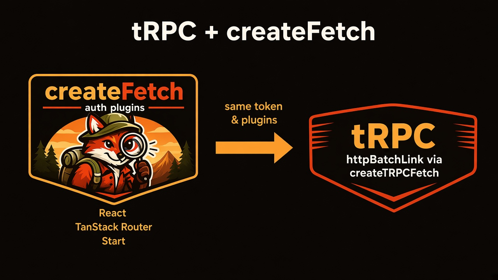

# tRPC helpers



`tanstack-fetch/trpc` sends tRPC's HTTP requests through `createFetch`. tRPC calls get the same auth, interceptors, status handlers, retries and DevTools as your REST calls, with no second HTTP setup.

```ts
import { createTRPCFetch, createTRPCFetchLink, createTRPCFetchClient } from 'tanstack-fetch/trpc'
```

| Helper                                    | Returns                                          | Use it when                                   |
| ----------------------------------------- | ------------------------------------------------ | --------------------------------------------- |
| `createTRPCFetch(source?)`                | `typeof fetch`                                   | You build the links yourself                  |
| `createTRPCFetchLink(options)`            | Terminating link (`httpBatchLink` or `httpLink`) | You compose links and want the last one ready |
| `createTRPCFetchClient<TRouter>(options)` | `createTRPCClient<TRouter>` with that one link   | You want a working client in one call         |

`@trpc/client` and `@trpc/server` (v10 or later) are optional peer dependencies. Install them only if you import this entry. Framework setups (TanStack Start, Next.js, Vue, Svelte and more) are in the [tRPC guide](/guide/trpc).

## `createTRPCFetch`: a fetch for tRPC links

```ts
createTRPCFetch(source?: CreateFetchOptions | FetchClient): typeof fetch
```

`source` can be:

- **A client from `createFetch()`** (core, `/sse` or `/live`). Its options and interceptors are reused.
- **A `CreateFetchOptions` object.** The option shortcuts work here: `getToken`, `auth`, `onUnauthorized`, `onStatus`, `plugins: ['trace', 'ssr-forward']`.
- **Nothing.** You get a plain fetch with the default timeout and retry budget.

An object that has `get` and `post` but was not made by `createFetch()` throws `pass CreateFetchOptions or a client from createFetch() to createTRPCFetch`.

```ts
import { createTRPCClient, httpBatchLink } from '@trpc/client'
import { createFetch } from 'tanstack-fetch'
import { createAuthInterceptor } from 'tanstack-fetch/plugins'
import { createTRPCFetch } from 'tanstack-fetch/trpc'
import type { AppRouter } from './server/router'

export const api = createFetch({
  interceptors: [createAuthInterceptor({ getToken: () => localStorage.getItem('token') })],
})

export const trpc = createTRPCClient<AppRouter>({
  links: [httpBatchLink({ url: '/api/trpc', fetch: createTRPCFetch(api) })],
})
```

::: warning Interceptors added later
`createTRPCFetch(api)` reads the options `api` was created with. Interceptors you add afterwards with `api.use()` don't run for tRPC calls. Pass them in `createFetch({ interceptors })` instead.
:::

### What runs on each tRPC request

- **Headers:** the client's `headers` are merged with the headers tRPC sets. tRPC's win on a conflict.
- **`onRequest` interceptors** run first: auth, trace, `ssr-forward`, refresh-token. `context.meta.operation` is `'trpc'`, so `match: { operation: 'trpc' }` targets tRPC calls only.
- **Timeout:** `timeoutMs` (default `30_000`) applies to each attempt, together with the signal tRPC passes in. The timer stops once the response arrives.
- **Network error:** `onRequestError` runs. If no interceptor asks to retry, the original error is rethrown and tRPC wraps it in a `TRPCClientError`.
- **Non-2xx response:** `onResponseError` runs, so status handlers, the refresh-token 401 retry and `retry-idempotent` all work. Without a retry, the `Response` goes back to tRPC unchanged. tRPC builds its own `TRPCClientError`, so procedure errors are **not** `FetchError`s.
- **2xx response:** `onResponse` runs (DevTools timing, logging). The body is left unread for tRPC.
- **Retries** share `maxRetries` (default `2`) and `context.meta.state` across attempts. tRPC queries are `GET` and mutations are `POST`, so `retry-idempotent` only retries queries.

## `createTRPCFetchLink`: a ready terminating link

```ts
createTRPCFetchLink(options: CreateFetchOptions & {
  url: string
  client?: FetchClient
  batch?: boolean
})
```

| Option   | Default | Meaning                                                                                             |
| -------- | ------- | --------------------------------------------------------------------------------------------------- |
| `url`    | —       | tRPC endpoint, absolute or relative (`/api/trpc`)                                                   |
| `client` | —       | Reuse a `createFetch()` client. When set, the other `createFetch` fields on this object are ignored |
| `batch`  | `true`  | `httpBatchLink`; `false` uses `httpLink`                                                            |

Any other `CreateFetchOptions` field (`baseUrl`, `headers`, `getToken`, `plugins`, `timeoutMs`, …) configures the fetch when `client` is not set.

```ts
import { createTRPCClient, loggerLink } from '@trpc/client'
import { createTRPCFetchLink } from 'tanstack-fetch/trpc'
import { api } from './api'
import type { AppRouter } from './server/router'

export const trpc = createTRPCClient<AppRouter>({
  links: [loggerLink(), createTRPCFetchLink({ url: '/api/trpc', client: api, batch: false })],
})
```

## `createTRPCFetchClient`: a client in one call

Takes the same options as `createTRPCFetchLink` and returns `createTRPCClient<TRouter>({ links: [createTRPCFetchLink(options)] })`. Pair it with `createTRPCOptionsProxy` from `@trpc/tanstack-react-query` to get `queryOptions()` for TanStack Query.

```ts
import { createTRPCFetchClient } from 'tanstack-fetch/trpc'
import { api } from './api'
import type { AppRouter } from './server/router'

export const trpcClient = createTRPCFetchClient<AppRouter>({ url: '/api/trpc', client: api })
```

## How the tRPC URL is resolved

tRPC calls fetch with the link `url` plus the procedure path. `createTRPCFetch` turns that into an absolute URL:

1. An absolute `http(s)` URL is used as is.
2. A relative URL with an absolute `baseUrl` is joined to it, and the base path is kept: `https://api.example.com/v1` + `/trpc/post.list` → `https://api.example.com/v1/trpc/post.list` (since 2.2.1).
3. A relative URL in the browser resolves against `location.origin`.
4. A relative URL on the server or at the edge, with no absolute `baseUrl`, throws `tRPC url "…" is relative; set an absolute baseUrl or link url for SSR and Edge runtimes`. Before 2.2.1 it silently called `http://localhost`.

## SSR: forward cookies and auth headers

On the server, the browser's cookies don't travel with your tRPC call. Set `source: 'ssr'`, pass the incoming request's headers as `incoming`, and add the `ssr-forward` plugin. It copies `cookie`, `authorization` and `requestId` (as `x-request-id`) onto the outgoing request. Create the client per request so one user's cookies never reach another request.

```ts
import { createTRPCFetchClient } from 'tanstack-fetch/trpc'
import type { AppRouter } from './server/router'

export const createServerTrpc = (request: Request) =>
  createTRPCFetchClient<AppRouter>({
    url: 'https://app.example.com/api/trpc',
    source: 'ssr',
    plugins: ['ssr-forward'],
    incoming: {
      cookie: request.headers.get('cookie') ?? undefined,
      authorization: request.headers.get('authorization') ?? undefined,
    },
  })
```

`incoming` can also be a function, which runs on every attempt. More SSR patterns: [SSR guide](/guide/ssr).

## Related

- [tRPC guide](/guide/trpc): setup per framework
- [Recipe · tRPC](/recipes/trpc): TanStack Start, Router context, SolidStart, Remix
- [Plugin API](/api/plugins): interceptors that run on tRPC calls
- [SSR](/guide/ssr): `source`, `incoming` and absolute URLs
